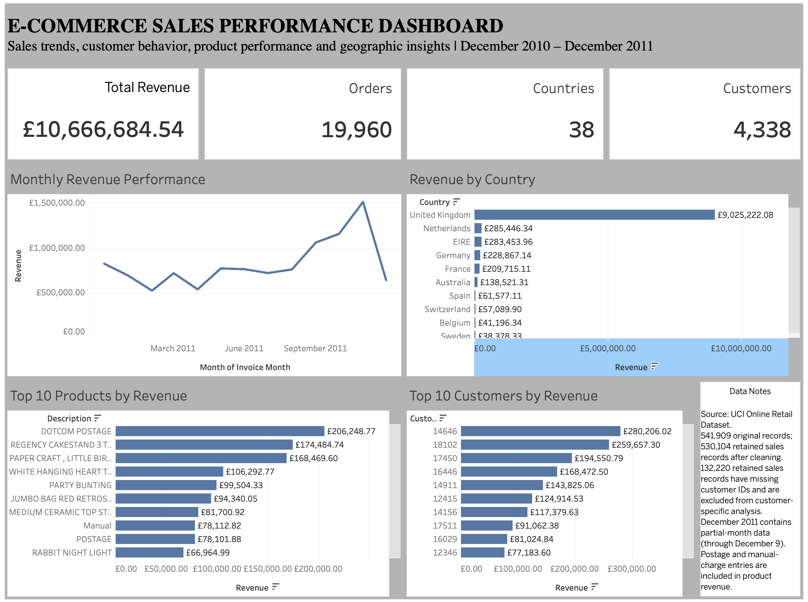

# E-Commerce Sales Analysis | Python, SQL & Tableau

An end-to-end data analytics project exploring e-commerce transactions to identify sales trends, product performance, customer purchasing behavior, and geographic revenue patterns.

## 📊 Live Tableau Dashboard

**[View Interactive E-Commerce Sales Dashboard on Tableau Public](https://public.tableau.com/app/profile/pavan.kalyan.poloju/viz/E-CommerceSalesPerformanceDashboard_17939119335790/E-CommerceSalesDashboard)**



*Interactive dashboard built using Tableau Public.*
## Project Overview

This project analyzes the UCI Online Retail dataset, containing more than 500,000 transaction records from a UK-based online retailer.

The objective is to transform raw transaction data into meaningful business insights through Python-based data cleaning, SQL analysis, and interactive Tableau visualizations.

## Tools & Technologies

- **Python:** Pandas, NumPy, Matplotlib
- **SQL:** SQLite, aggregations, joins, subqueries, business analysis
- **Tableau Public:** Interactive dashboards and data visualization
- **Excel:** Source dataset inspection
- **Git & GitHub:** Project version control and documentation

## Dataset

- **Source:** [UCI Machine Learning Repository – Online Retail](https://archive.ics.uci.edu/dataset/352/online+retail)
- **Original records:** 541,909
- **Cleaned sales records:** 530,104
- **Countries represented:** 38

The dataset contains invoice numbers, product descriptions, quantities, invoice dates, unit prices, customer IDs, and countries.

## Project Workflow

1. **Data Collection:** Downloaded the original Excel dataset.
2. **Data Cleaning:** Used Python and Pandas to clean and standardize transaction data, handle invalid records, and calculate revenue.
3. **Data Transformation:** Generated processed datasets for monthly sales, products, countries, customers, and KPIs.
4. **Database Development:** Loaded cleaned transaction records into SQLite.
5. **SQL Analysis:** Developed queries to evaluate revenue, orders, products, customers, and purchasing trends.
6. **Visualization:** Built an interactive Tableau dashboard to communicate key findings.

## Key Business Insights

| Business Metric | Result |
|---|---:|
| Total Revenue | £10,666,684.54 |
| Total Orders | 19,960 |
| Known Customers | 4,338 |
| Countries | 38 |
| Average Order Value | £534.40 |
| Units Sold | 5,588,376 |
| Repeat Customer Rate | 65.58% |

### Additional Findings

- **Geographic performance:** The United Kingdom generated approximately £9.03 million in revenue, making it the dominant market.
- **Monthly sales:** November 2011 was the highest-revenue month, generating approximately £1.51 million.
- **Customer retention:** Approximately 65.58% of customers with known IDs made repeat purchases.
- **Product performance:** Regency Cake Stand 3 Tier was among the strongest physical products by revenue.
- **Weekly trends:** Thursday recorded the highest revenue among the weekdays represented in the dataset.

## Tableau Dashboard Features

The interactive dashboard includes:

- Total Revenue KPI
- Total Orders KPI
- Known Customers KPI
- Total Countries KPI
- Monthly Revenue Performance
- Revenue by Country
- Top 10 Products by Revenue
- Top 10 Customers by Revenue

**[Explore the Live Dashboard](https://public.tableau.com/app/profile/pavan.kalyan.poloju/viz/E-CommerceSalesPerformanceDashboard_17939119335790/E-CommerceSalesDashboard)**

## Project Structure

```text
ecommerce-sales-analysis/
│
├── data/
│   ├── raw/
│   └── processed/
│       ├── clean_sales.csv
│       ├── monthly_sales.csv
│       ├── product_performance.csv
│       ├── country_performance.csv
│       ├── customer_performance.csv
│       ├── data_quality_summary.csv
│       └── project_kpi_summary.csv
│
├── reports/
│   └── Generated analysis charts
│
├── sql/
│   ├── 01_create_tables.sql
│   ├── 02_analysis_queries.sql
│   └── 03_data_quality_checks.sql
│
├── src/
│   ├── download_data.py
│   ├── analysis.py
│   ├── load_database.py
│   ├── test_sql.py
│   └── run_sql_analysis.py
│
├── requirements.txt
├── README.md
└── .gitignore
```

## How to Run the Project

### 1. Clone the repository

```bash
git clone https://github.com/pk090-lab/ecommerce-sales-analysis.git
cd ecommerce-sales-analysis
```

### 2. Install dependencies

```bash
pip install -r requirements.txt
```

### 3. Download the dataset

```bash
python src/download_data.py
```

### 4. Run Python data analysis

```bash
python src/analysis.py
```

### 5. Create the SQLite database

```bash
python src/load_database.py
```

### 6. Execute SQL analysis

```bash
python src/run_sql_analysis.py
```

## Data Quality Considerations

- The original dataset contains 541,909 records; 530,104 valid sales records were retained for analysis.
- A total of 132,220 retained sales records have missing Customer IDs. These are excluded from customer-specific metrics.
- December 2011 is a partial month because the dataset ends on December 9, 2011.
- Postage and manual-charge entries are included in product revenue, so product-level results should be interpreted accordingly.
- An unusually large Paper Craft transaction was identified and should be investigated before drawing conclusions about typical product demand.

## Future Improvements

- Develop customer segmentation using RFM analysis.
- Perform cohort-based customer retention analysis.
- Build sales forecasting models.
- Investigate unusual transactions and outliers.
- Add automated data quality reporting.

## Author

**Pavan Kalyan Poloju**

Data Analyst | Python | SQL | Tableau | Power BI

- [GitHub Repository](https://github.com/pk090-lab/ecommerce-sales-analysis)
- [Tableau Public Portfolio](https://public.tableau.com/app/profile/pavan.kalyan.poloju)

---

*This project was developed for educational and professional portfolio purposes using the publicly available UCI Online Retail dataset.*